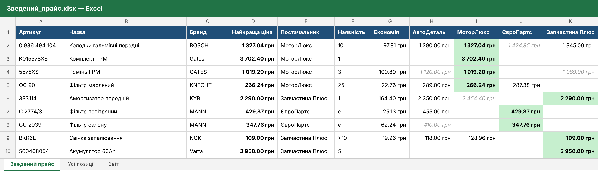
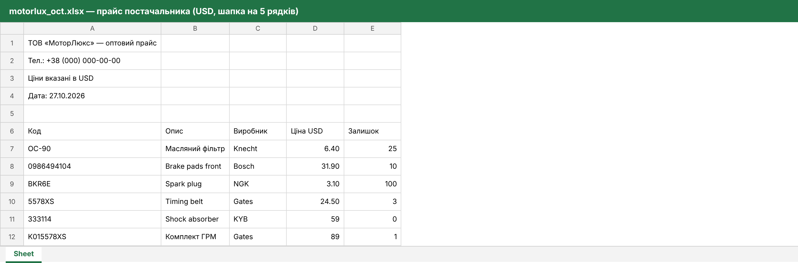

# Зведення прайсів постачальників в один Excel

Скрипт на Python для магазину, який працює з кількома постачальниками. Кожен постачальник надсилає прайс у своєму форматі: в одного артикул у першій колонці, в іншого в третій, хтось пише ціни в доларах, хтось у гривнях, у когось шапка на 5 рядків. Раніше ці прайси зводили вручну.

**Як працює:** кладете прайси в папку `input/` → запускаєте → отримуєте один Excel, де кожна деталь в одному рядку з найкращою ціною та постачальником, а ціни інших постачальників стоять поруч для порівняння.



_Демо-дані: постачальники, ціни й залишки вигадані._

## Можливості

- **Різна структура прайсів** описується в `config.json`: рядок шапки, колонки за назвою («Артикул») або літерою («C»), валюта. Новий постачальник додається без зміни коду.
- **Формати:** `.xlsx` і `.csv` (роздільник `;` або `,`, кодування UTF-8 або Windows-1251).
- **Курс валют з НБУ** автоматично (USD, EUR тощо). Без інтернету курс можна задати вручну: `--rate USD=41.5` або в `config.json`.
- **Розумне зведення артикулів:** `OC 90`, `oc-90` та `OC.90` вважаються однією деталлю.
- **Розбір «брудних» даних:** ціни `1 234,50`, `$12.5`, `109 грн`, `1.234,50`; наявність `є`, `+`, `-`, `під замовлення`, `>10`, числа.
- **Найкраща ціна з урахуванням наявності:** позиція, якої немає на складі, не обирається найкращою. Якщо товару немає ніде, рядок виділяється сірим.
- **Підсвічування:** найкраща ціна виділена зеленим, ціни без наявності показані сірим курсивом. Окремою колонкою йде економія порівняно з найдорожчою пропозицією.
- **Додаткові аркуші:** «Усі позиції» (вихідні дані з номером рядка у файлі, щоб легко перевірити) і «Звіт» (курси, кількість позицій і пропущених рядків по кожному файлу, помилки).
- **Націнка** у відсотках (опційно).
- **Збірка в `.exe`:** замовнику не потрібно встановлювати Python.

Приклад вхідного прайсу (шапка на 5 рядків, ціни в USD):



## Запуск

```bash
pip install -r requirements.txt
copy config.example.json config.json      # Linux/macOS: cp
python tools/make_samples.py              # демо-прайси в input/ (за бажанням)
python merge_prices.py
```

У Windows можна просто двічі клацнути **«Зведення прайсів.bat»**.

### Збірка .exe

```bash
build_exe.bat
```

У папці `dist/` з'являться `Зведення прайсів.exe`, `config.json` і папка `input/`. Їх можна передати замовнику.

## Налаштування постачальника

```json
{
  "name": "МоторЛюкс",
  "file": "motorlux*.xlsx",
  "header_row": 6,
  "currency": "USD",
  "columns": {"article": "A", "name": "B", "brand": "C", "price": "D", "stock": "E"}
}
```

| Поле | Що означає |
|---|---|
| `file` | шаблон імені файлу в `input/` (якщо підходить кілька файлів, береться останній за назвою) |
| `header_row` | номер рядка з назвами колонок |
| `columns` | назва колонки з шапки або літера колонки; обов'язкові `article` і `price` |
| `currency` | `UAH`, `USD`, `EUR`… |

## Структура

```
price-list-merger/
├── merge_prices.py      # запуск
├── config.example.json  # приклад налаштувань постачальників
├── merger/
│   ├── readers.py       # читання xlsx/csv з різною структурою
│   ├── normalize.py     # артикули, ціни, наявність
│   ├── nbu.py           # курс НБУ + ручний курс
│   ├── core.py          # зведення та вибір найкращої ціни
│   └── writer.py        # підсумковий Excel з форматуванням
├── tools/make_samples.py
└── tests/               # 12 тестів
```

## Тести

```bash
python -m pytest
```

Покривають розбір цін і наявності, зведення артикулів, вибір найкращої ціни з урахуванням наявності, конвертацію валют, обробку помилок налаштувань і повний прогін на демо-прайсах.

**Технології:** Python 3.10+, openpyxl, API НБУ, PyInstaller.
